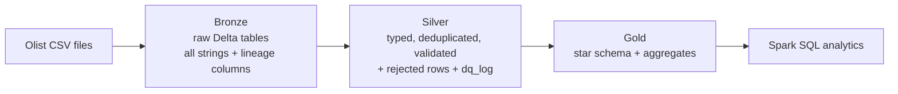

# E-Commerce Data Pipeline (Medallion Architecture) on Databricks

An end-to-end ETL pipeline built with **PySpark, Delta Lake and Spark SQL** on the public
[Olist Brazilian E-Commerce dataset](https://www.kaggle.com/datasets/olistbr/brazilian-ecommerce) (Kaggle).
Raw CSVs are ingested into a **bronze** layer, cleaned and validated in **silver**, and modeled as a
**star schema** with business aggregates in **gold**.

## Architecture

| Layer | What happens | Main tables |
|---|---|---|
| **Bronze** | Load each CSV unchanged (all columns as strings); add `_ingested_at` and `_source_file` | `customers`, `orders`, `order_items`, `payments`, `reviews`, `products`, `sellers`, `geolocation`, `category_translation`, `ingestion_log` |
| **Silver** | Cast types, standardise text, drop duplicate keys, apply data quality rules, enforce foreign keys, quarantine bad rows | cleaned tables, `<table>_rejected`, `dq_log` |
| **Gold** | Star schema and aggregates | `fact_order_items` (partitioned by year and month), `fact_payments`, `dim_date`, `dim_customer`, `dim_product`, `dim_seller`, `agg_monthly_revenue`, `agg_category_performance`, `agg_state_delivery` |

## Data quality approach
- Every silver table runs through one reusable framework (`00_config.py`): rules are written as
  conditions that must be true for a valid row.
- Rows that fail any rule are **not silently dropped**: they go to `olist_silver.<table>_rejected`
  with the names of the rules they broke.
- Every check (duplicates, rule failures, orphan foreign keys) is logged with row counts to
  `olist_silver.dq_log`, and raw row counts are logged to `olist_bronze.ingestion_log`.
- Examples: delivered orders must have a delivery date, delivery cannot be before purchase,
  price must be positive, review score must be 1 to 5, coordinates must fall inside Brazil,
  order items must reference an existing order, product and seller.
- The gold notebook ends with assertions (no empty fact table, no duplicate or null keys).

## How to run
1. Download the dataset from Kaggle and upload the 9 CSV files to a Databricks volume or folder.
2. Import the `notebooks/` folder into Databricks (or use a Git folder pointing at this repo).
3. Open `00_config.py` and set `RAW_PATH` (and `CATALOG` if needed).
4. Run in order: `01_bronze` -> `02_silver` -> `03_gold` -> `04_analytics`.

## Analytics included (`04_analytics.py`)
Top sellers per state (`RANK`), month-over-month growth (`LAG`), cumulative revenue
(`SUM() OVER`), category revenue share, and repeat-customer rate.

## Results
Numbers below come from my run on Databricks (log tables `ingestion_log`, `dq_log` and the gold tables).

| Metric | Value |
|---|---|
| Records ingested into bronze | about 1.55 million rows across 9 tables (geolocation is about 1.0 million of them) |
| Data quality checks in silver | 30 validation and referential-integrity checks, plus 7 duplicate-key checks |
| Orders rejected | 8 delivered orders with no delivery date; their 8 order items, 8 payments and 8 reviews were then removed by foreign key checks |
| Other rejections | 2 payments with fewer than 1 installment, 3 payments with an undefined payment type, 42 geolocation rows outside Brazil |
| Geolocation | about 1.0 million rows aggregated to about 19,000 (one row per zip prefix) |
| Rows in `fact_order_items` | 112,642 (gold validation passed: no duplicate or null keys) |

### Key findings (delivered orders, Sep 2016 to Aug 2018)
- **Revenue:** about 13.22 million in total product revenue (BRL, excluding freight). It grew strongly through 2017, peaked in November 2017 (+52.4% month over month, consistent with Black Friday timing), then flattened at roughly 0.83 to 0.98 million per month in 2018.
- **Categories:** `health_beauty` (9.3%), `watches_gifts` (8.8%) and `bed_bath_table` (7.7%) lead; the top 5 categories make up about 40% of revenue.
- **Customers:** only about 3% (2,801 of 93,350) placed a repeat order, so the marketplace is mostly acquisition-driven.
- **Sellers:** revenue is concentrated. SP, RJ and MG have the biggest sellers, and in BA the top seller earns about 12 times the second one.

### Data notes
2016 has only three sparse months (none in November), so month-over-month growth is only meaningful from 2017.

## Design decisions and limitations
- **Bronze stores everything as strings** so ingestion never fails on bad data; typing happens in silver.
- **Natural keys** (for example `customer_id`) are used in the dimensions instead of surrogate keys,
  to keep the model simple and readable.
- **ANSI mode is switched off** in the config so malformed values become NULL and are caught by
  the quality rules instead of crashing the job.
- **The dataset is small** (about 100K orders), so Spark is more than it needs. The pipeline is
  written so the same code scales to much larger data.
- Possible extensions: incremental loads with Auto Loader, scheduling with Databricks Workflows,
  Delta Live Tables expectations, and a BI dashboard on the gold tables.

## Tech stack
Python, PySpark, Spark SQL, Delta Lake, Databricks.

## Dataset
Olist Brazilian E-Commerce Public Dataset (Kaggle). The data is not included in this repo; please
check the dataset's license on Kaggle.
